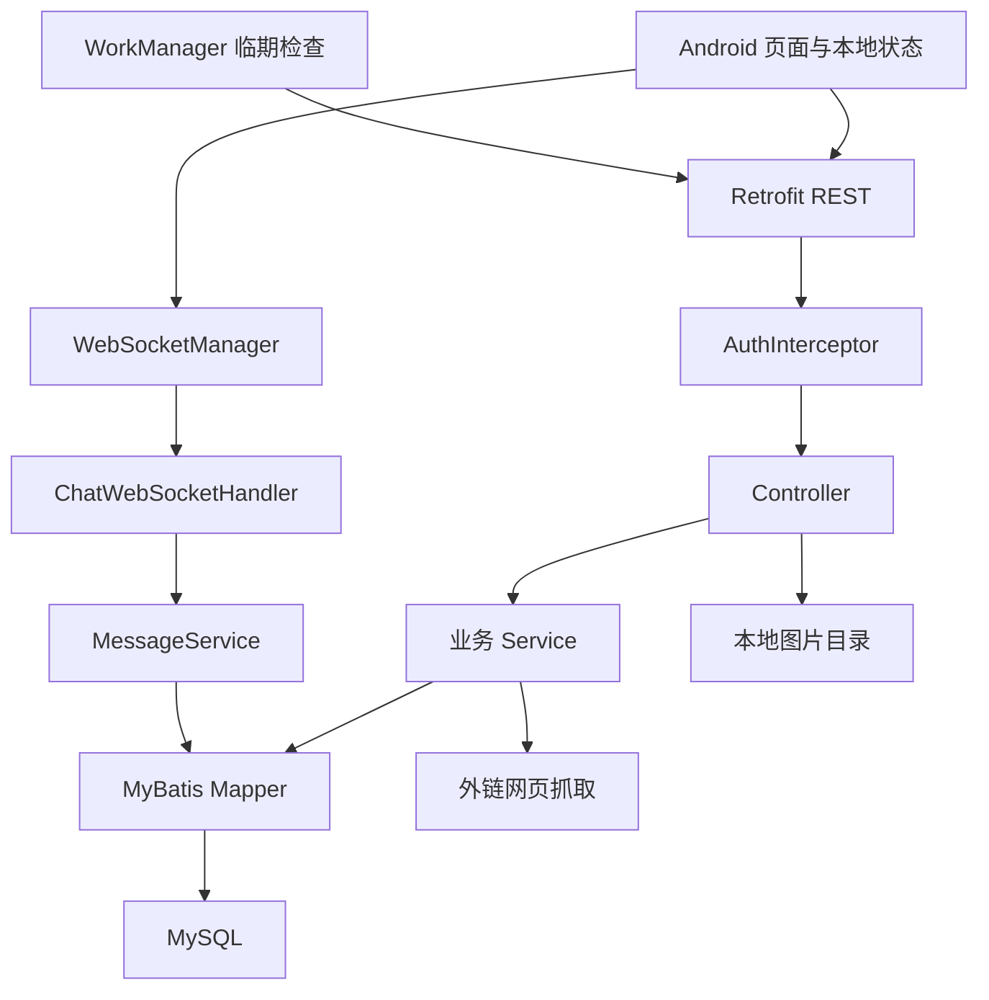

# FamilyRecipes 项目理解与改进评审

> 归档于 2026-11-01；评审基线 `b180637`。本文保留首次评审结论；后续设计和实施状态分别见 [详细设计](./02-design.md) 与 [实施计划](./03-plan.md)。代码行号对应评审基线，文件变化后可能偏移。

# 项目定位与现有功能

评审日期：2026 年 11 月 1 日。代码基线：`b180637`。本次为静态代码与说明文档评审，未修改仓库文件，未启动服务、执行数据库脚本或进行真机测试；以下区分代码已确认的问题与运行环境待验证项。

**我的理解：家肴是一个围绕家庭日常做饭的工具，正在从个人菜谱收藏和冰箱记账，向家庭共享厨房发展。** 最有价值的使用路径是“保存想做的菜 → 知道家里有什么 → 优先消耗临期食材 → 决定今天做什么 → 家人共同维护”。目前菜谱、库存和社交模块已经分别搭起，但共享范围、数据流转和异常处理还没有形成可靠闭环。

整体适合继续迭代。优先事项是修复身份与数据权限、避免编辑丢数据、统一接口和数据库结构，再完善家庭协作。现阶段增加更多社交入口、营养分析或复杂推荐，会放大已有维护成本。

## 功能现状

| 模块 | 当前代码体现的能力 | 尚未闭合的部分 |
| --- | --- | --- |
| 账号 | 邮箱注册登录、JWT、本地登录状态、个人页 | 服务端默认用户模式仍开启；账号隔离不可靠 |
| 菜谱 | 标题、描述、封面、标签、外链解析、收藏、差评、详情与编辑 | 后端支持结构化食材和步骤，但 Android 编辑器尚未维护；编辑有清空旧数据风险 |
| 搜索 | 菜谱关键词、标签、创建者等筛选；混合搜索菜谱和食材 | 两套搜索规则不同；全局搜索不做菜谱可见性过滤 |
| 推荐 | 按浏览量获取菜谱列表 | “随机推荐”实际重新取热门列表，未结合库存或临期食材 |
| 冰箱 | 自由文本录入、保质期、存放位置、消耗与删除、分类侧栏 | 分类和所属人字段未贯通；临期查询与状态更新矛盾 |
| 家庭厨房 | 厨房名称、本地厨房 ID、菜谱群组可见性字段 | 切换厨房仍为占位；库存按个人 userId 查询，未形成共享库存边界 |
| 好友与群组 | 扫码加好友、创建群组、群组列表、成员管理后端 | 好友列表与消息首页的 Adapter 未接上；群设置等入口仍占位 |
| 群聊 | 历史消息、消息列表、原始 WebSocket 收发代码 | 认证、环境地址、字段协议、发送确认、重连和消息合并需要修复 |
| 图片与提醒 | 上传接口、图片选择、WorkManager 定期检查 | 图片关联和访问路径未闭环；提醒开关及失败处理需完善 |

**文档不能直接代表当前完成度。** README 描述了尚未在客户端完成的结构化菜谱；社交开发文档将群聊页面列为待实现，但当前已有 GroupChatActivity；“80%”“85%”“100%”缺少统一验收标准。建议以后按“已实现并验证／已实现待验证／占位／计划”记录功能状态。

参考：[README.md](../../../README.md)、[SOCIAL_FEATURE_DEVELOPMENT.md](../../../SOCIAL_FEATURE_DEVELOPMENT.md)、[QUICKSTART_UPDATED.md](../../../QUICKSTART_UPDATED.md)、[MainActivity.kt](../../../android/app/src/main/java/com/familyrecipes/android/ui/MainActivity.kt#L254)、[MessageFragment.kt](../../../android/app/src/main/java/com/familyrecipes/android/ui/message/MessageFragment.kt#L1)、[FriendsListActivity.kt](../../../android/app/src/main/java/com/familyrecipes/android/ui/social/FriendsListActivity.kt#L37)。

# 技术架构

## 当前组织方式

Android 使用 Kotlin、Activity／Fragment、XML 布局与 ViewBinding，通过 Retrofit／OkHttp 调用 REST；SharedPreferences 保存账号、配置及厨房选择，WorkManager 负责定时提醒。页面直接承担请求、转换、状态更新和交互逻辑。

后端是 Java 17、Spring Boot 3.2.2 单体，按 Controller → Service → MyBatis Mapper → MySQL 分层。菜谱、库存、配置、好友、群组和消息在同一服务中。图片写入本地目录；聊天通过独立原始 WebSocket Handler，连接集合保存在进程内。STOMP 控制器已停用，不能把它当成正在运行的第二套聊天服务。

该图表达主要调用关系；公开接口会跳过 AuthInterceptor，WebSocket 也没有经过 REST 的 JWT 校验。

## 值得保留的设计

- **单体部署符合个人项目体量。** 一套后端与数据库容易理解、备份和排障，没有必要现在拆微服务。

- **后端已有明确分层与事务。** 菜谱创建／更新、群组成员变更等操作已使用事务，可在现有结构上修补业务规则。

- **核心关系基本清晰。** 菜谱与标签、食材、步骤分别建模；群组成员和已读位置单独存储，有继续演进的基础。

- **已考虑真实录入体验。** 分享文本解析、自由输入食材、解析后确认、外链抓取失败后保留基础信息，都适合家庭场景。

- **已有环境区分的起点。** Android REST 地址通过 BuildConfig 区分 debug／release，只需将聊天和图片地址纳入统一配置。

## 主要架构欠缺

**业务实体直接作为 API 输入输出，导致字段泄漏、命名不一致和过度更新。** 应逐步增加请求 DTO 与响应 DTO，明确字段是否必填、谁可修改、空值是什么意思。权限规则由服务端集中执行，页面隐藏按钮仅用于交互。

**Android 页面承担过多职责。** EditRecipeActivity 853 行、AddIngredientActivity 661 行、FridgeFragment 536 行。建议按功能逐步引入 ViewModel 和 Repository，让页面只渲染状态、发送用户事件；先改菜谱编辑和冰箱两个高风险模块，无需重写所有页面或更换 UI 框架。

**共享厨房尚未成为一致的业务边界。** 当前混合使用 userId、ownerGroupId、sharedGroupIds 和本地 currentKitchenId。建议先明确“群聊是否等于家庭厨房”：若群聊只是沟通渠道，Kitchen／Household 应作为独立领域概念；若决定一群一厨房，也要统一成员权限和库存归属。不要仅把一个客户端传来的 groupId 当成授权依据。

**可见性关系应便于校验。** sharedGroupIds 目前是 TEXT 内的 JSON 字符串。后续可改为菜谱与共享群组的关联表，以便约束重复、查询成员可见性和处理退群后的访问撤销。

参考：[pom.xml](../../../backend/pom.xml)、[ApiClient.kt](../../../android/app/src/main/java/com/familyrecipes/android/data/remote/ApiClient.kt)、[RawWebSocketConfig.java](../../../backend/src/main/java/com/familyrecipes/config/RawWebSocketConfig.java)、[Recipe.java](../../../backend/src/main/java/com/familyrecipes/entity/Recipe.java)。

# 主要问题与证据

优先级定义：**P0** 为真实多用户使用或对外开放前的阻断项；**P1** 为核心流程正确性、数据完整性和构建复现问题；**P2** 为后续维护与体验改进。代码问题的存在不等于已经在线上发生，实际暴露范围取决于部署版本和网络配置。

## P0 身份与资源权限

### 1 默认用户模式让认证失去边界

AuthInterceptor 的 DEV_MODE 固定为 true。缺少、失效或无法解析的 token 都会变成用户 1，并继续执行请求。这会把未登录请求和过期会话的写操作归到默认账号。

**建议：** 开发身份仅在明确的本地 profile 中允许；部署环境缺 token 或 token 无效统一拒绝。公开读取使用显式匿名身份，不借用真实用户。

**验收：** 无 token、伪造 token、过期 token 均不能创建、修改、删除或消耗数据。关闭开发模式时还需修正公开路由白名单：其中的 /api/recipes/list 和 /api/recipes/*/detail 与真实 Controller 路由并不一致。

证据：[AuthInterceptor.java](../../../backend/src/main/java/com/familyrecipes/interceptor/AuthInterceptor.java#L24)、[WebConfig.java](../../../backend/src/main/java/com/familyrecipes/config/WebConfig.java#L20)、[RecipeController.java](../../../backend/src/main/java/com/familyrecipes/controller/RecipeController.java#L98)。

### 2 菜谱可见性字段没有成为访问控制

private／group／public 已可写入，但详情 findById、列表 XML 查询、全局关键词／标签搜索及最近常做查询没有实施相应可见性过滤。更新菜谱仅按 id 写库，没有像删除操作那样核对创建者。旧外链添加接口也没有资源归属校验。

**影响：** 用户界面显示“仅自己”或“群组可见”会产生错误的隐私预期；关闭开发模式仍不能消除越权读取和编辑。

**建议与验收：** 建立统一的“可读／可编辑／可删除”判断，覆盖所有入口；使用用户 A、同群 B、外部 C 分别验证详情、搜索、热门／最近列表和修改接口，退群后立即失去相应访问权。

证据：[RecipeService.java](../../../backend/src/main/java/com/familyrecipes/service/RecipeService.java#L114)、[RecipeMapper.java](../../../backend/src/main/java/com/familyrecipes/mapper/RecipeMapper.java#L13)、[RecipeMapper.xml](../../../backend/src/main/resources/mapper/RecipeMapper.xml#L5)。

### 3 用户密码摘要随菜谱响应返回

RecipeService 在详情与列表直接装入 userMapper.findById 返回的 User，厨师查询也返回 u.*。User 含 password 且没有序列化排除；只有账号控制器等少数路径主动置空。

**影响：** 返回的是密码摘要而非明文，但仍属于不应出现在客户端的认证数据。UserService 当前使用无盐 SHA-256，进一步增加离线猜测风险。

**建议：** 返回明确的公开用户 DTO，只包含 id、显示名、头像等必要字段；密码摘要在统一序列化边界禁止输出，并规划带盐、适合密码存储的哈希及旧账号迁移。

**验收：** 对所有含用户对象的响应做字段断言，任何嵌套层级均不出现 password。

证据：[RecipeService.java](../../../backend/src/main/java/com/familyrecipes/service/RecipeService.java#L186)、[User.java](../../../backend/src/main/java/com/familyrecipes/entity/User.java#L10)、[RecipeCookMapper.java](../../../backend/src/main/java/com/familyrecipes/mapper/RecipeCookMapper.java#L13)、[UserService.java](../../../backend/src/main/java/com/familyrecipes/service/UserService.java#L113)。

### 4 群聊可以绕开真实用户身份

/ws/chat 仅配置 HttpSessionHandshakeInterceptor，没有 JWT 绑定。订阅处理直接将连接加入指定群组；发送者 senderId 来自客户端消息体。MessageService 虽检查群成员资格，但检查的是客户端声称的身份。

**建议：** 握手时认证并绑定用户，发送者从服务端会话取得；订阅、发送、成员移除和退群均检查／撤销权限。

**验收：** 未登录连接被拒绝；外部用户不能订阅群；修改 senderId 无法冒充其他人；被移除的成员不能继续接收广播。

证据：[RawWebSocketConfig.java](../../../backend/src/main/java/com/familyrecipes/config/RawWebSocketConfig.java#L27)、[ChatWebSocketHandler.java](../../../backend/src/main/java/com/familyrecipes/websocket/ChatWebSocketHandler.java#L63)、[ChatWebSocketHandler.java](../../../backend/src/main/java/com/familyrecipes/websocket/ChatWebSocketHandler.java#L118)。

### 5 库存消耗缺少归属检查

consume 接口只接收 itemId，Service 和 SQL 都不检查用户。库存更新同样只按 id 更新；它还存在下文的字段错误，不能把当前报错当成权限保障。删除接口已有归属检查，可作为统一规则的起点。

**验收：** 用户 B 对用户 A 的库存执行消耗、更新、删除，全部失败且原记录不变。

证据：[FridgeController.java](../../../backend/src/main/java/com/familyrecipes/controller/FridgeController.java#L60)、[FridgeService.java](../../../backend/src/main/java/com/familyrecipes/service/FridgeService.java#L88)、[FridgeItemMapper.java](../../../backend/src/main/java/com/familyrecipes/mapper/FridgeItemMapper.java#L38)。

### 6 上传与网页抓取缺少服务端边界

上传接口被排除认证，仅相信客户端 Content-Type 以 image/ 开头，未验证实际图片内容；已有 10MB 请求限制，但没有按账号配额或孤立文件回收。外链解析接受通用 URL，服务器直接抓取并跟随重定向，没有目标地址校验，存在服务端请求内部地址的风险，实际可达范围需结合部署网络核验。

**建议：** 上传绑定用户并解码验证图片、限制尺寸与格式、统一生成后缀；抓取限制协议、目标地址和每次重定向，设置并发与资源预算。解析失败时允许保存原链接。

证据：[FileUploadController.java](../../../backend/src/main/java/com/familyrecipes/controller/FileUploadController.java#L45)、[WebScrapingService.java](../../../backend/src/main/java/com/familyrecipes/service/WebScrapingService.java#L62)、[ExternalLinkParser.java](../../../backend/src/main/java/com/familyrecipes/util/ExternalLinkParser.java#L142)。

## P1 数据正确性与可复现运行

### 7 编辑菜谱会删除已有食材和步骤

Android 更新请求明确传 ingredients = null、steps = null。后端更新时先删除原有关联，再在非 null 时插入。因此，对已有结构化食材／步骤的菜谱只修改标题，也会清掉这些数据。cookUserIds 参数在更新流程没有实际处理，另有接口行为不一致。

**建议：** 明确局部更新语义：未传字段保留、空数组明确清空、非空数组替换；或让完整替换接口强制提交完整数据。不能让 UI 不支持的字段被隐式删除。

**验收：** 带食材和步骤的菜谱仅改标题，关联数据保持不变；明确清空才删除。

证据：[EditRecipeActivity.kt](../../../android/app/src/main/java/com/familyrecipes/android/ui/recipe/EditRecipeActivity.kt#L574)、[RecipeService.java](../../../backend/src/main/java/com/familyrecipes/service/RecipeService.java#L114)。

### 8 当前源码存在字段缺失，需核对可运行版本来源

IngredientParser.ParseResult 没有 ownerUserId，但构造时传入该命名参数；AddIngredientActivity 读取 parseResult.ownerUserId，并向同样没有该字段的 Android FridgeItem 构造函数传参。按当前声明，这些是 Kotlin 源码层面的编译阻断。

后端 FridgeItemMapper.update 引用 ownerName，但 Java FridgeItem 没有该属性；临期 SQL 使用 owner_user_id，而仓库建表及迁移中未找到该列定义。前者会影响更新参数绑定，后者影响按仓库脚本新建环境的查询。

**建议：** 先记录已运行 APK／后端包对应的 commit、构建配置与数据库版本，再与当前仓库对齐。本次未执行编译，因此不声称已验证整个构建失败，也不否定已有安装包可运行。

证据：[IngredientParser.kt](../../../android/app/src/main/java/com/familyrecipes/android/util/IngredientParser.kt#L16)、[IngredientParser.kt](../../../android/app/src/main/java/com/familyrecipes/android/util/IngredientParser.kt#L107)、[AddIngredientActivity.kt](../../../android/app/src/main/java/com/familyrecipes/android/ui/fridge/AddIngredientActivity.kt#L527)、[Models.kt](../../../android/app/src/main/java/com/familyrecipes/android/data/model/Models.kt#L162)、[FridgeItemMapper.java](../../../backend/src/main/java/com/familyrecipes/mapper/FridgeItemMapper.java#L40)、[FridgeItem.java](../../../backend/src/main/java/com/familyrecipes/entity/FridgeItem.java#L12)。

### 9 临期提醒的状态规则互相冲突

库存列表读取会将临期记录改成 expiring；提醒查询却要求 status = normal，因而排除已刷新状态的临期记录。getExpiringItems 和 Worker 没有根据 reminderSetting.enabled 决定是否发送，提醒时间也未接入每日任务调度。

**建议：** 库存生命周期保留“在库／已消耗”等事实，临期与过期尽量根据日期计算；或者所有读取与提醒使用同一状态规则。明确每天检查是近似调度，不能承诺精确钟点。

**验收：** 同一批食材在打开库存页前后提醒结果一致；关闭提醒后不通知；已消耗项不通知；跨日期边界结果一致。通知授权及设备后台行为仍需真机验证。

证据：[FridgeItemMapper.java](../../../backend/src/main/java/com/familyrecipes/mapper/FridgeItemMapper.java#L49)、[FridgeService.java](../../../backend/src/main/java/com/familyrecipes/service/FridgeService.java#L120)、[ExpiryReminderWorker.kt](../../../android/app/src/main/java/com/familyrecipes/android/worker/ExpiryReminderWorker.kt)、[FamilyRecipesApp.kt](../../../android/app/src/main/java/com/familyrecipes/android/FamilyRecipesApp.kt)。

### 10 分类侧栏的数据源没有贯通

客户端按 ingredient.categoryId 筛选，后端 Ingredient 没有 categoryId，库存列表 JOIN 也只取名称和旧 category。迁移 008 修改的是 ingredients，但现有主表和 Mapper 使用 ingredient。

**影响：** UI 有分类侧栏，不代表库存有可筛选的分类数据。仅修复表名仍不足以完成该功能。

**建议与验收：** 统一分类字段、实体、写入／读取 SQL 和 API；新增物品选择分类后，刷新、重启及重新登录仍出现在对应分类。一级分类是否包含子类也要统一。

证据：[FridgeFragment.kt](../../../android/app/src/main/java/com/familyrecipes/android/ui/fridge/FridgeFragment.kt#L134)、[Ingredient.java](../../../backend/src/main/java/com/familyrecipes/entity/Ingredient.java)、[FridgeItemMapper.java](../../../backend/src/main/java/com/familyrecipes/mapper/FridgeItemMapper.java#L14)、[008_create_inventory_categories.sql](../../../backend/src/main/resources/migrations/008_create_inventory_categories.sql#L62)。

### 11 聊天环境与数据协议不一致

REST release 地址来自 BuildConfig，但 WebSocket 地址写死为模拟器本机地址。后端原始 Handler 自建 ObjectMapper，消息字段按 camelCase 输出；Android Message 按 group_id、sender_id、created_at 等 snake_case 字段解析。保存消息后仅返回插入对象，未补齐数据库生成时间与发送者信息。

此外，历史 SQL 按时间倒序，界面原样加入后滚到底部，新消息又追加末尾；历史请求返回时 messages.clear() 还可能清掉先收到的实时消息。发送后立即清空输入，没有等待业务确认；连接失败后未看到自动重连和断线补拉逻辑。

**建议：** 统一 REST／WebSocket 配置与消息 DTO，使用稳定消息 ID 排序、去重及补拉；增加发送中／成功／失败状态。服务端持久化后回传完整消息，客户端收到确认再处理输入。

**验收：** release 包在真机可聊天；重连不漏、不重；历史与实时消息顺序正确；断网发送保留内容；发送者和时间正常显示。

证据：[WebSocketManager.kt](../../../android/app/src/main/java/com/familyrecipes/android/websocket/WebSocketManager.kt#L37)、[ChatWebSocketHandler.java](../../../backend/src/main/java/com/familyrecipes/websocket/ChatWebSocketHandler.java#L27)、[MessageService.java](../../../backend/src/main/java/com/familyrecipes/service/MessageService.java#L28)、[Models.kt](../../../android/app/src/main/java/com/familyrecipes/android/data/model/Models.kt#L276)、[GroupChatActivity.kt](../../../android/app/src/main/java/com/familyrecipes/android/ui/social/GroupChatActivity.kt#L125)、[MessageMapper.java](../../../backend/src/main/java/com/familyrecipes/mapper/MessageMapper.java#L32)。

### 12 数据库初始化与迁移不是一条可重复执行的路径

application.yml 每次启动执行 schema.sql 和 data.sql，并允许忽略错误；增量 migrations 未纳入自动版本管理。005 已定义 manager_id，006 又添加同一列；008 有表名不一致。schema.sql 与 schema_no_fk.sql 并存，但删除业务依赖外键级联，选用不同脚本会改变数据清理行为。

**建议：** 确定唯一基线并采用有版本记录的迁移流程；已有库先确认实际结构再建立迁移基线。测试种子数据与部署环境隔离，迁移错误必须可见。不要以删表重建作为日常升级方法。

**验收：** 空库安装、已有库升级、重复启动三种场景全部通过，业务数据保留，并能从备份恢复。线上库当前是否手工补过字段需核验。

证据：[application.yml](../../../backend/src/main/resources/application.yml#L16)、[005_create_social_tables.sql](../../../backend/src/main/resources/migrations/005_create_social_tables.sql#L19)、[006_update_group_roles.sql](../../../backend/src/main/resources/migrations/006_update_group_roles.sql#L5)、[schema_no_fk.sql](../../../backend/src/main/resources/schema_no_fk.sql)。

### 13 图片上传成功不等于业务保存成功

新增库存上传了图片并得到 imageUrl，但构造库存请求时没有使用它。菜谱允许上传多张，创建／更新实际只保存第一张作为封面，其余没有图片集合关联。默认上传 URL 指向 localhost 的 /files/，WebConfig 未配置该目录的文件系统映射；部署是否另有代理映射需要核验。

**建议：** 先决定每类业务支持单图还是多图，保证界面能力、数据模型和上传行为一致；所有成功上传文件可访问、可关联，取消发布或删除业务后有明确回收策略。

证据：[AddIngredientActivity.kt](../../../android/app/src/main/java/com/familyrecipes/android/ui/fridge/AddIngredientActivity.kt#L488)、[EditRecipeActivity.kt](../../../android/app/src/main/java/com/familyrecipes/android/ui/recipe/EditRecipeActivity.kt#L393)、[application.yml](../../../backend/src/main/resources/application.yml#L55)、[WebConfig.java](../../../backend/src/main/java/com/familyrecipes/config/WebConfig.java#L36)。

## P2 体验与维护成本

### 14 界面生命周期和失败状态需要统一

多个 Fragment 使用自身 lifecycleScope，在 onDestroyView 清空 binding 后，异步结果或 finally 仍可能访问 binding。RecommendFragment 在 onViewCreated 和 onResume 都发请求，存在重复加载和旧结果覆盖新结果的可能。部分失败仅打印日志或 Toast，界面难以区分“没有数据”和“没有加载成功”。

**建议：** 请求状态由 ViewModel 管理，视图观察使用视图生命周期；同一页面避免重复初始请求，保留加载／空／错误／重试状态。该类生命周期风险需通过慢网与页面切换复现确认。

证据：[RecommendFragment.kt](../../../android/app/src/main/java/com/familyrecipes/android/ui/recommend/RecommendFragment.kt#L87)、[RecommendFragment.kt](../../../android/app/src/main/java/com/familyrecipes/android/ui/recommend/RecommendFragment.kt#L175)、[MessageFragment.kt](../../../android/app/src/main/java/com/familyrecipes/android/ui/message/MessageFragment.kt)。

### 15 API 契约与错误处理缺少统一约束

注册请求字段有校验注解，但入口没有 @Valid；分页参数缺少范围上限。REST 使用全局 snake_case，但部分请求 DTO、Map 返回和聊天协议保留 camelCase。Controller 大量捕获 Exception 后返回业务错误对象，HTTP 层常仍为成功，且直接暴露异常 message。

**建议：** 定义 API 字段、枚举、分页上限、空值与错误码；使用明确 DTO 和统一异常转换。让客户端区分认证过期、权限不足、输入错误、服务故障和网络故障，避免只依赖 isSuccessful。

证据：[AuthController.java](../../../backend/src/main/java/com/familyrecipes/controller/AuthController.java#L27)、[RecipeController.java](../../../backend/src/main/java/com/familyrecipes/controller/RecipeController.java#L115)、[application.yml](../../../backend/src/main/resources/application.yml#L30)、[Models.kt](../../../android/app/src/main/java/com/familyrecipes/android/data/model/Models.kt#L245)。

### 16 搜索与统计需要符合功能名称

全局搜索先读取全部命中记录再在 Java 分页；菜谱列表为每项再查用户与标签，形成逐条补查。当前小规模可接受，但数据增长后会放大查询量。推荐按钮按浏览量重复请求，不具备随机性；“记录烹饪”只累加全局计数，没有记录谁在何时做过。详情方法还会增加浏览数，创建和更新后也调用它，导致计数包含内部读操作。

**建议：** 先统一产品语义，再将分页下推数据库、批量获取关联数据。做饭历史应保存用户／厨房与时间，热门计数可由这些事实派生；推荐优先采用可解释的简单规则，例如临期食材、已有食材和近期去重。

证据：[SearchService.java](../../../backend/src/main/java/com/familyrecipes/service/SearchService.java#L36)、[RecipeService.java](../../../backend/src/main/java/com/familyrecipes/service/RecipeService.java#L208)、[RecipeService.java](../../../backend/src/main/java/com/familyrecipes/service/RecipeService.java#L278)、[RecommendFragment.kt](../../../android/app/src/main/java/com/familyrecipes/android/ui/recommend/RecommendFragment.kt#L91)。

### 17 测试和说明尚未形成可靠的维护保障

仓库发现的后端测试集中在 ExternalLinkParser，另有会写数据的 API shell 脚本，未看到 Android 测试源码或 CI 工作流。现有无认证脚本把默认用户模式当作成功标准，不能作为多用户发布验收。已有小红书测试期望完整 /o/... 路径，但解析正则只能匹配第一段，静态可见测试期望与实现冲突，需实际运行确认。

日志也偏开发态：后端记录完整 Authorization，Android HTTP 日志固定 BODY；应按环境关闭敏感内容。README、部署指南与当前工程的入口、产物名称和已实现能力需要统一。根目录 Gradle 配置 include(:app)，实际 Android app 在 android/app，建议明确唯一构建入口。

**建议：** 先覆盖权限、编辑保留数据、临期提醒和迁移四条主线，再扩展测试。补上干净环境构建说明、版本对应关系、备份恢复步骤和最小健康检查。

证据：[ExternalLinkParserTest.java](../../../backend/src/test/java/com/familyrecipes/util/ExternalLinkParserTest.java)、[ExternalLinkParser.java](../../../backend/src/main/java/com/familyrecipes/util/ExternalLinkParser.java#L33)、[test-api-no-auth.sh](../../../test-api-no-auth.sh)、[AuthInterceptor.java](../../../backend/src/main/java/com/familyrecipes/interceptor/AuthInterceptor.java#L44)、[ApiClient.kt](../../../android/app/src/main/java/com/familyrecipes/android/data/remote/ApiClient.kt#L21)、[settings.gradle.kts](../../../settings.gradle.kts)。

# 改进路线与验收建议

## 第一阶段 先建立可相信的运行基线

1. 对齐已运行安装包、后端产物、源码 commit 和数据库结构，解决缺失字段及迁移冲突。

2. 关闭部署环境默认身份，封住菜谱、库存和群聊越权；移除所有用户响应中的密码摘要。

3. 修复编辑菜谱清空食材／步骤、临期查询矛盾以及客户端／服务端字段契约。

4. 验证图片访问与 release 真机聊天，形成可重复的构建和部署记录。

完成标准：从干净环境能构建并安装；空库能初始化；两个不同账号互不越权；核心数据编辑前后完整保留。对于已经对外部署的版本，应优先处理上述 P0 暴露面。

## 第二阶段 完成家庭做饭的核心闭环

- **共享厨房：** 明确成员、角色、库存归属、菜谱可见性和离开家庭后的访问规则。

- **可靠库存：** 分类与图片持久化、批次和部分消耗、误操作撤销、临期列表与提醒一致。

- **菜谱使用：** 让标题／外链收藏路径保持轻量，同时可逐步补结构化食材、步骤、份量和个人笔记。

- **今天吃什么：** 先根据临期食材、库存匹配、时间预算和近期做过的菜排序，给出推荐理由；购物清单在数量和单位规则清楚后再生成。

- **社交入口：** 接上已有好友与群列表；没有完成的功能入口先明确标注或收起，减少“点进去只有开发中”的体验。

这些是产品方向建议，不是当前已实现能力。最先需要明确的产品决策是：主要服务“个人收藏”，还是“同住家人共享厨房”。若以后者为主，共享库存和权限应早于新增社交功能。

## 第三阶段 降低后续迭代成本

保留 Spring Boot 单体与现有 Android 技术栈，按功能抽取 DTO、权限策略、ViewModel 和 Repository。统一配置、时间规则与错误码，增加请求追踪和必要指标。数据量或部署规模证明需要时，再考虑搜索服务、分布式消息和更多缓存；当前进程内 WebSocket 连接表适合单实例，多实例部署前才需要跨实例广播方案。

## 最小验收清单

| 场景 | 通过条件 |
| --- | --- |
| 身份 | 无 token、过期 token 均不能修改数据 |
| 菜谱权限 | 私有／群组菜谱在详情、搜索、推荐、编辑路径使用一致规则 |
| 用户输出 | 响应任意层级均不含 password |
| 编辑完整性 | 仅改标题保留食材、步骤和已有图片 |
| 库存 | 他人不能消耗；分类和图片保存后可重新读取 |
| 临期提醒 | 打开列表前后结果一致；关闭提醒有效；消耗后不提醒 |
| 聊天 | 真机 release 连接成功；身份正确；断线补拉无重复、无丢失 |
| 数据库 | 空库安装、旧库升级和重复启动结果一致 |
| 构建 | 新环境按唯一说明能生成对应版本的客户端与后端 |
| 恢复 | 能从备份还原菜谱、库存、成员关系及关联图片 |

## 本次结论的边界

源码中的默认身份、权限遗漏、字段缺失、更新清空逻辑及迁移冲突已经通过调用链与定义交叉核对。部署环境是否覆盖配置、数据库是否手工补列、已有 APK 是否来自不同版本、代理是否映射图片目录，以及真机通知／页面切换的实际表现，仍需后续运行验证。此次没有执行会创建数据的 API 脚本，也没有将静态推断记为测试通过。

主要阅读范围包括 README、快速启动与社交说明、构建和部署说明，以及认证、菜谱、库存、搜索、群组、消息、上传、外链解析、Android 主要页面、网络层、模型和数据库脚本。
