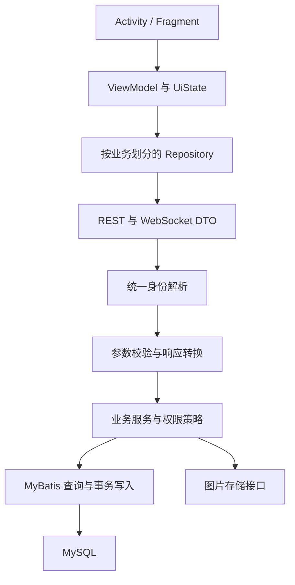

# 基础可靠性与家庭协作详细设计

> 本文为首次候选设计。本轮范围已按用户要求缩小为未上线、单机、本地媒体的基础修复；现行决策与已实现内容见 [04 实施记录](./04-implementation.md)。迁移、共享厨房和 UI 重构不在本轮执行范围。

日期：2026-11-01\
状态：设计草案，未实施\
评审基线：`b180637`\
前置材料：[原始评审](./01-review.md)\
执行入口：[实施与验收计划](./03-plan.md)

本文把首次评审转成可实施的设计。保留 Spring Boot 单体、MyBatis、MySQL 和原生 Android；先保证身份可信、数据不丢、行为可验证，再推进共享厨房。

所有新增表、API 和类名均为拟议设计，不代表仓库已有实现。现有安装包与源码、数据库的对应关系需要在第一工作包建立。

## 1. 范围与默认决策

| 编号 | 决策 | 理由及边界 |
| --- | --- | --- |
| D01 | 先修复现有个人数据路径，再引入厨房共享 | 不让领域重构阻塞权限和数据丢失修复 |
| D02 | 厨房与群聊分开建模；一个厨房可绑定一个群聊 | 厨房管理库存归属，群聊管理沟通；不默认把所有聊天群变成家庭 |
| D03 | 菜谱归创建者，分享只授予读取权 | 第一版不支持多人同时编辑同一道菜，避免管理员权限泛化 |
| D04 | 个人库存仅本人可改；厨房成员可维护共享库存 | “谁录入”与“谁有权维护”分开；所属人仅是标签 |
| D05 | 新接口使用 snake_case 和明确 DTO | 保持现有主要实体序列化习惯，消除 Map 与 WebSocket 的例外 |
| D06 | 菜谱局部更新区分未传、null、空数组 | 防止编辑器不支持的字段被删除 |
| D07 | 临期状态由日期计算，库存生命周期独立存储 | 消除查询触发状态更新带来的提醒差异 |
| D08 | 第一版单实例后端、在线编辑、设备本地提醒 | 不引入微服务、完整离线同步、多实例广播或精确闹钟 |
| D09 | 图片先支持菜谱与库存各一张主图 | 与实际持久化能力一致；多图和步骤图后续独立设计 |
| D10 | 历史共享信息无法验证时降为私有 | 不能为了迁移成功而扩大已有数据可见范围 |

D02、D03、D04、D09 是产品默认方案，后续可调整。真正进入共享厨房实施前，应确认“成员是否都可维护库存”“菜谱是否需要家庭共同编辑”“是否保留多图”三个问题；安全和数据修复无需等待这些产品决定。

## 2. 目标结构与改造位置



| 位置 | 具体改造 |
| --- | --- |
| AuthInterceptor / JwtUtil | 删除部署环境默认身份回退；提供 REST 与 WS 共用的认证服务 |
| controller / dto | 请求与响应类分离，禁止直接接收或返回持久化实体 |
| RecipeService / RecipeMapper | 统一可见性、条件更新、关联数据保留、批量读取 |
| FridgeService / FridgeItemMapper | 归属条件进入查询、派生临期状态、修复分类与图片 |
| ChatWebSocketHandler / MessageService | 会话绑定身份、授权订阅、幂等写入、统一消息 DTO |
| Android data | 增加 RecipeRepository、InventoryRepository、ChatRepository、SessionRepository |
| Android ui | 先拆 EditRecipe 与 Fridge 页面状态，再拆聊天；保留 XML／ViewBinding |
| resources | 单一迁移目录；开发种子数据、生产配置和迁移分开 |

第一轮可以复用现有拦截器，不同时迁移整个安全框架。权限策略不能仅放 Controller：HTTP、WebSocket 和内部业务调用都必须通过服务层的相同规则。

## 3. 身份、会话与资源权限

### 3.1 身份规则

引入 CurrentUser，只有 user_id 与必要账号状态；身份来自已验证 token，不接受请求体中的 creator_id、sender_id、user_id 覆盖当前用户。

- 无 token：只有显式公开读取接口允许匿名。
- token 失效、签名错误或账号不可用：返回 401；即使访问公开 API，也不将错误身份悄悄降成默认用户。
- 生产环境没有默认账号回退；本地调试优先使用测试登录，不保留硬编码 DEV_MODE。
- JWT 密钥从部署环境获取，禁止使用仓库示例密钥启动生产配置。
- 第一版不实现 refresh token；过期后重新登录，避免保留一个不存在的 refresh 接口承诺。
- 用户表增加 token_version；JWT 包含对应版本，密码修改／显式“退出所有设备”时递增。主动退出当前设备只清本地状态，不宣称服务端撤销所有旧 token。
- REST 每次校验有效期与版本；WS 握手校验，连接记录到期时间，到期关闭；发送和订阅时再次检查，账号撤销时清理连接。

密码方案：新密码采用 BCrypt，算法参数通过部署性能测量确定。旧 SHA-256 摘要在成功登录时升级；明确区分 BCrypt 与旧摘要格式，未知格式拒绝并进入重置流程。密码和摘要不得进入日志。开发种子账号不能自动覆盖真实账号。

### 3.2 权限矩阵

“成员”指当前有效成员，好友关系不自动授予菜谱、库存或聊天权限。

| 资源／动作 | 匿名 | 创建者／个人所有者 | 有访问权的成员 | 外部登录用户 |
| --- | --- | --- | --- | --- |
| 公开菜谱读取 | 允许 | 允许 | 允许 | 允许 |
| 私有菜谱读取 | 拒绝 | 允许 | 拒绝 | 拒绝 |
| 群组／厨房共享菜谱读取 | 拒绝 | 允许 | 允许 | 拒绝 |
| 菜谱编辑、删除、调整分享 | 拒绝 | 允许 | 拒绝 | 拒绝 |
| 收藏、差评、烹饪记录 | 拒绝 | 可读时允许 | 可读时允许 | 公开菜谱允许 |
| 个人库存读写 | 拒绝 | 允许 | 拒绝 | 拒绝 |
| 厨房库存读写 | 拒绝 | 需为当前成员 | 允许 | 拒绝 |
| 聊天订阅、发送、历史、未读 | 拒绝 | 需为当前群成员 | 允许 | 拒绝 |
| 群管理／厨房成员管理 | 拒绝 | 需具备对应 manager 角色 | 普通成员拒绝 | 拒绝 |

不可见资源返回 404，避免通过错误信息确认私有资源存在；可见但不可编辑返回 403。所有搜索、计数、最近列表、收藏列表、推荐和图片读取都必须遵循同一可见性规则，不能只过滤列表后保留未过滤 total。

短期群组可见性：private 仅创建者；public 所有人；group 为创建者或合法分享群的有效成员。owner_group_id 非空时需合并进合法分享集合，创建／变更时校验操作者成员资格；集合为空的 group 菜谱仅创建者可读。不得把空集合解释为全部群组。

全局库存分类为系统字典，首轮只提供客户端读取／匹配；分类创建、更新、删除接口先关闭，对外不暴露管理能力。以后真正需要后台时再引入平台管理员权限，不能仅凭“仅管理员”的注释判断安全。

### 3.3 并发授权边界

库存写 SQL 至少带资源 id 与所有者／厨房授权条件，并检查影响行数。授权检查和写入放在同一事务；共享成员变更与共享写入采用一致的厨房行锁顺序，保证移除成员提交后开始的写入被拒绝。菜谱版本冲突返回 409。

群组创建先对成员去重、移除创建者，验证用户存在及邀请资格，再计算人数；不再“先计数、后跳过”。成员变更锁定群组行，人数从实际成员记录计算。数据库唯一键阻止重复成员；manager 转让必须原子更新角色和 manager_id。

## 4. API 契约与兼容策略

### 4.1 通用响应

新增和改造接口保留 code／message／data 外壳，错误使用真实 HTTP 状态。新增 error_code 与 request_id；code 暂保留数字，避免客户端一次性大改。

```json
{
  "code": 409,
  "error_code": "VERSION_CONFLICT",
  "message": "内容已被更新，请刷新后重试",
  "request_id": "服务端生成的追踪标识",
  "data": null
}
```

| 状态 | 场景 |
| --- | --- |
| 400 | 参数缺失、类型错误、非法枚举、分页越界 |
| 401 | 未认证、会话过期 |
| 403 | 已有读取权限但无操作权限 |
| 404 | 不存在或无读取权限 |
| 409 | 版本冲突、重复幂等键但内容不同、业务状态冲突 |
| 413 / 415 | 上传超限／格式不支持 |
| 429 | 上传、登录、抓取等超出频率限制 |
| 500 | 未预期故障，仅返回通用信息和 request_id |

page_size 默认 20、上限 100，page_num 从 1 开始。列表输出统一 list、total、page_num、page_size；聊天使用游标而非页号。请求体、集合条数和字符串长度均设限；建议菜名 100、用户名 50、消息 4000 字符，最终与数据库列宽统一。

日期用 YYYY-MM-DD，时间点用 UTC ISO 8601；数据库连接时区统一 UTC。日期字段不做 UTC 日期漂移转换，临期比较使用用户／厨房的明确时区。

### 4.2 升级顺序

1. 后端先修复权限和敏感字段输出，旧路径也必须安全，不能让兼容层保留漏洞。
2. 对未改变语义的字段保持兼容；新增 DTO 显式接受必要的旧命名别名，不能依赖静默忽略未知字段。
3. 新的局部更新使用 PATCH；旧 PUT 作为有期限适配层，集合缺失／null 保留、空数组清空。适配层先读取原记录并应用字段白名单，不接受修改所有者。
4. Android Repository 统一解析 HTTP 错误与业务错误，再升级功能页面。
5. 记录最低支持客户端版本；达到下线条件后删除适配层。升级前冻结 JSON 样例和契约测试，不能仅比较 Kotlin／Java 字段名。

现有可能返回 null 的字段应在客户端声明可空；新必填字段不能依赖 Gson 对缺失字段的默认行为。

## 5. 菜谱编辑、分享和统计

### 5.1 局部更新规则

目标接口：PATCH /api/recipes/{id}。

```json
{
  "version": 3,
  "name": "番茄炒蛋",
  "description": null,
  "tags": []
}
```

该请求仅修改标题、清空描述和标签，保留食材、步骤、会做的人、封面及外链。

| 字段类型 | 未传 | 显式 null | 非空值／数组 |
| --- | --- | --- | --- |
| name、visibility | 保留 | 拒绝 | 校验后替换 |
| description、cover_asset_id | 保留 | 清空 | 校验后替换 |
| tags、ingredients、steps、external_links | 保留 | 新 PATCH 拒绝 | 数组整体替换，[] 表示清空 |
| version | 拒绝 | 拒绝 | 必须等于当前版本 |

DTO 需要保存“字段是否出现”，可用专门 PatchField 表达，不能用普通 nullable 字段混淆未传和 null。

事务顺序：读取并校验编辑权 → 校验关联资源 → UPDATE WHERE id AND version → 检查影响行数 → 只替换请求出现的关联集合 → version 加一 → 返回纯查询结果。任何失败回滚全部修改。详情查询不再顺带增加浏览次数；如保留浏览统计，单独定义并去重，不将内部查询算作浏览。

外链 added_by 由服务端设置；修改链接归属必须经过菜谱编辑权限。关联食材必须存在；步骤序号必须唯一、排序明确。会做的人首轮保留原数据，后续仅允许用户自行声明／撤销，不允许创建者替他人随意声明。

### 5.2 分享模型

先新增 recipe_shared_group(recipe_id, group_id)，联合主键，替代 TEXT 中的 JSON。解析旧 shared_group_ids 后只导入存在且有效的群组；非法 JSON、失效 ID 与缺失归属输出迁移报告，默认私有。

共享厨房阶段新增 recipe_kitchen_share(recipe_id, kitchen_id)，不把群组 ID 直接当厨房 ID。仅在用户明确选择转换群组为厨房后迁移相应分享；其他群组分享保留。可读条件为创建者、public 或任一合法群组／厨房分享匹配。只要仍在另一个分享范围内，退出其中一个群组不撤销其全部访问权。

### 5.3 幂等和烹饪记录

新收藏／差评 API 使用 PUT 设置目标状态、DELETE 删除，不使用重试后会反转的 toggle。现有唯一键保留，计数从事实记录核对，更新事务避免重复累加。

做过一次菜写 cooking_history，保存 actor、时间、可选 kitchen_id 和 client_request_id；唯一幂等键避免网络重试重复记录。近期统计从时间窗口内历史产生，旧累加计数不能伪造为历史事件。用户点击“做过”不自动消耗库存，后续提供可确认的消耗清单。

## 6. 库存、分类与提醒

### 6.1 数据规则

保留每次购买／入库为独立批次，不按名称自动合并不同保质期的库存。

| 字段 | 设计 |
| --- | --- |
| user_id | 现阶段个人所有者；共享阶段为原始录入人，不能作为共享写权限唯一依据 |
| kitchen_id | 可空；null 表示个人库存，否则为厨房共享库存 |
| lifecycle_status | active、consumed；不持久化 normal／expiring／expired 派生状态 |
| expiry_date | 业务日期；默认值允许用户确认修改 |
| expiry_state | 响应派生 normal、expiring、expired |
| amount | 保留原始文本；例如“半袋”，不强制解析成数字 |
| quantity、unit | 后续部分消耗使用，可空；不确定数值时只支持整批消耗 |
| category_id | 库存分类覆盖，可空；优先于食材字典默认分类 |
| assigned_to_user_id | 可选所属人标签，必须是本人或当前厨房成员，不授予权限 |
| image_asset_id | 可空，持久化图片关联 |
| version | 并发编辑版本 |

先删除／修复现有 ownerUserId、ownerName 的悬空引用，使编译与绑定一致；不要只补一个字段而遗漏 DTO、SQL、迁移和客户端。旧所属人若没有可靠存储记录，不猜测归属。

分类分两步：修复 ingredient.category_id 全链路，允许“其他／未分类”；共享阶段支持库存条目级覆盖，避免修改全局同名食材影响其他家庭。分类字典用稳定 code 关联种子数据，不依赖自增 ID 恰好为 1、2、3。一级筛选包含所有子类，未分类作为独立选项。

### 6.2 临期算法

在用户／厨房时区得到 today：

- lifecycle_status != active：不进入库存临期提醒。
- expiry_date < today：expired。
- today <= expiry_date <= today + days_before_expiry：expiring。
- 其他：normal。

读取库存不执行状态 UPDATE。临期接口查询 active 与日期范围，过期项单独显示；关闭提醒不隐藏临期列表，只停止通知发送。兼容客户端仍可收到旧 status，由生命周期和临期状态组合生成。

个人库存按用户时区，共享库存按厨房时区；提醒响应携带 as_of_date 与 timezone，避免设备和服务器跨日不一致。

### 6.3 提醒执行

第一版使用 WorkManager 做近似每日检查，界面不承诺指定分钟到达。enabled、days_before_expiry 必须生效；reminder_time 保留迁移信息但不作为精确调度承诺。

Worker 开始先确认当前登录会话；请求完成后再确认账号未切换。401 停止并等待重新登录；临时网络／5xx 退避重试；普通 4xx 不无限重试。通知授权不足时返回可理解状态，不把无权限当作成功推送。

本地以账号、厨房／个人范围、业务日期记录已通知批次，避免一天内反复通知；允许显示同一 ID 的通知更新。logout 取消账号任务并清理通知；login 按账号创建唯一任务。多设备可能分别提醒，第一版明确接受，不承诺跨设备去重。

## 7. 共享厨房的最小领域模型

新增 kitchen(id, name, manager_user_id, timezone, version, archived_at) 与 kitchen_member(kitchen_id, user_id, role, joined_at)，成员联合唯一。group_chat 增加可空且唯一的 kitchen_id，表示可选绑定；厨房成员资格与群聊成员资格各自校验，不推断等价。

- 默认保留每人的个人库存；不自动迁移到家庭。
- 创建厨房时创建者成为 manager；邀请需被邀请人接受，第一版无需公开邀请码或搜索陌生人。
- 成员可新增、编辑、消耗共享库存；服务端保存操作者与变更时间。
- 只有 manager 邀请／移除成员、修改厨房信息、转让管理和归档。
- 转让事务确认目标为现有成员，保证最终有且仅有一个 manager。
- manager 不能直接退出，先转让或归档。归档保留数据并禁止普通写操作。
- 成员离开后失去共享库存访问；其创建的个人菜谱仍归本人，厨房对已分享菜谱的可见性由分享记录及作者后续操作决定。
- 从个人转移库存到厨房必须显式选择、确认目标成员资格并携带 version；旧记录原子变更归属，不用复制制造双份库存。
- currentKitchenId 是 UI 选择，不是权限凭据；切换账号清空该选择，启动时重新获取可访问厨房。

这套规则不实现“离职式内容收归家庭”，也不把管理员变成所有个人内容的所有者。若需要家庭共同拥有菜谱，应另立所有权设计与数据迁移。

## 8. 聊天协议与可靠性

### 8.1 统一配置和连接

WS 地址由同一 API origin 推导：http → ws，https → wss，路径为 /ws/chat；如代理前缀不同，通过显式 ws_base_url 配置覆盖。release 禁止模拟器地址；REST 与 WS 复用会话信息。

Android 原生 WS 握手用 Authorization header；不把 token 放 URL。每条连接保存 actor、过期时间和订阅群组集合。订阅、历史读取、未读数、已读与发送均校验成员身份；移除／退群提交后撤销相应订阅。广播前重新确认接收资格，避免已撤销订阅继续收到新消息。

### 8.2 发送与确认

```json
{
  "command": "SEND",
  "request_id": "客户端生成并持久保存的 UUID",
  "body": {
    "group_id": 12,
    "client_message_id": "客户端生成并持久保存的 UUID",
    "content": "今晚做番茄炒蛋",
    "message_type": "text"
  }
}
```

客户端不得提交 sender_id。首轮只开放 text；system 仅服务端产生，image 待资源授权完善后开放。

message 增加 client_message_id 与 group_sequence；唯一键为 (sender_id, client_message_id)，另有 (group_id, group_sequence)。同一幂等键重试必须返回原消息；若正文或群组不同返回 409。历史 system 消息可暂用 null 幂等键。

发送事务锁群组序列行、复核成员资格、分配单调序号、插入消息并返回完整 MessageResponse；提交后 ACK 与广播。完整响应包含 id、group_id、group_sequence、sender_id、sender 摘要、created_at。REST 发送与 WS 发送调用同一业务路径。

ACK 表示已持久化，广播失败不撤销数据库消息；客户端靠补拉恢复。服务端不承诺恰好一次网络投递，幂等键和客户端去重实现一次展示。共用配置好的序列化器，禁止 Handler 单独 new ObjectMapper。

### 8.3 历史与重连

首次历史按 group_sequence 降序取最新 N 条，响应按升序展示；加载更早消息使用 before_sequence。断线补拉使用 after_sequence，分页直到服务器高水位。不能仅用自增消息 id 假定提交顺序；群组序列在持锁事务内分配，保证同群提交顺序。

流程：注册消息观察者 → 认证连接并订阅 → 订阅成功后拉历史 → 按消息 id／client_message_id 合并。历史返回不能清空已收到的实时消息。订阅 ACK 返回高水位以便检测遗漏；同一批历史使用稳定边界。

Android 发送状态为 pending、sent、failed；发送前持久化 pending 内容与幂等键，ACK 后改 sent，失败保留重试入口。使用轻量本地数据库保存 pending 和游标，仅用于聊天可靠性，不扩展为全业务离线同步。退出账号关闭连接、停止重试，缓存按账号隔离。

重连采用带随机抖动的指数退避，上限 30 秒；主动退出页面／账号不自动重连。前台重新进入后补拉；无后台推送时不承诺离线即时通知。

已读位置使用 group_sequence，校验消息属于群组且不大于当前高水位，写入采用 max(old, new)，不允许倒退。成员加入前是否允许查看历史：默认允许读取该群保留历史；如以后改为仅加入后可见，必须同步改历史、未读与补拉规则。

## 9. 图片与外链

### 9.1 图片资源

新增 asset(id, uploader_id, storage_key, media_type, byte_size, state, created_at)，状态为 pending、attached、deleted。服务端解码验证支持的图片并重新编码，限制字节和像素；存储键由服务端生成，不使用原始文件名作为路径。上传需要认证并设账号配额。

业务只引用 asset_id；关联时校验上传者／授权，业务事务成功后标记 attached。失败或取消产生的 pending 文件按保留期清理，建议初始 24 小时，可配置。删除资源采用延迟清理并再次检查引用，避免误删仍被使用的图片。

**私有菜谱不能仅保护 JSON 而公开原图。** 图片读取按关联业务授权，使用携带身份的读取接口；Android 图片加载对本服务资源附加认证，对外部缩略图不附加 token。第一版不依赖永久公开文件 URL，避免不可撤销的分享泄漏。

旧 cover_image 字符串分为本服务上传路径与外部 URL：本地文件检查存在性后建立 asset 记录；外链保留来源信息，不自动批量下载。已公开的旧路径需要部署侧关闭或迁移，不能声称换了 DTO 就撤销了旧链接。

### 9.2 外链抓取

解析分享文本与抓网页元信息分开。先返回可保存的 URL／标题，再可选抓取；超时不阻塞保存。小红书等正则不得截断多段路径；使用 URI 解析相对链接与最终重定向地址，不靠字符串拼接。

抓取限制 http／https、拒绝 userinfo 和非允许端口；解析并校验所有目标 IP，拒绝 loopback、私网、链路本地、保留地址与 IPv6 对应范围。每次重定向重新验证，建议最多 3 次；连接目标必须绑定已验证地址或通过受限出站代理，不能只做一次 DNS 检查后再解析。

设置总超时、响应大小和并发上限，不转发客户端认证头或 Cookie，不返回原始 HTML。图片缩略图地址同样按外部 URL 处理；不自动请求服务器内部图片地址。

## 10. Android 状态与交互

每个首批改造模块定义 UiState：Loading、Content、Empty、Error；编辑页另外保存 Draft、Saving、Conflict。ViewModel 处理业务事件，Repository 处理 DTO、HTTP 错误和重试，Fragment 仅观察视图生命周期中的状态。

- 使用 viewLifecycleOwner 观察 UI；请求结束不再访问已销毁 binding。
- 同一搜索／筛选只接受最新请求结果，取消或丢弃旧结果；避免 onViewCreated 与 onResume 重复首刷。
- 401 统一进入登录失效状态，保留不敏感草稿；取消账号任务、聊天和缓存观察，禁止落回用户 1。
- 409 显示“内容已被更新”，保留本地草稿并提供刷新比较；不能自动覆盖他人的版本。
- 图片上传失败允许重试，不显示“保存成功”；按钮在请求中禁用，但真正防重复靠服务端幂等。
- 配置旋转后保留草稿；进程死亡恢复只保存必要字段，token 与密码不进入 SavedState。
- 群列表、好友列表接上 Adapter 与空／错误状态；未实现的菜单、作品等入口暂收起。
- 推荐先改名为热门菜谱以符合现状；库存推荐在下一阶段通过可解释规则实现。

## 11. 数据库迁移和上线

建议引入 Flyway 作为唯一迁移执行器；具体依赖版本在实施时依据现有 Spring Boot 兼容范围核验。以下是迁移顺序，不是可直接运行的 SQL。

| 顺序 | 内容 | 校验 |
| --- | --- | --- |
| M00 | 导出实际 schema、记录运行包版本、创建可恢复备份 | 在隔离库恢复成功 |
| M01 | 建立版本化基础结构，消除 005／006 重复定义和 ingredient 表名冲突 | 空库可重建、非空库结构可比对 |
| M02 | 补 version、token_version、分类和图片字段 | 缺失引用、非法分类被报告 |
| M03 | 回填 recipe_shared_group，旧 JSON 保留只读备份 | 行数核对、非法分享默认私有 |
| M04 | 回填库存生命周期，保留旧状态兼容输出 | normal／expiring／expired → active；consumed 保持消耗 |
| M05 | 建立 asset 与消息幂等、群序列；历史消息按 created_at、id 稳定回填 | 唯一约束与游标分页验证 |
| M06 | 厨房表、成员表及可选归属字段 | 不自动迁移个人库存或所有群聊 |

全新库走整理后的唯一初始化迁移。已有库必须先审计并补齐到确认过的基线，才能显式标记 baseline；禁止对任意已有数据库自动 baseline 后假定结构一致。历史脚本归档，不再同时由 Spring SQL init 执行。开发数据通过独立 profile 或手工 fixture 导入。

按“扩展字段／表 → 后端兼容读写 → 客户端升级 → 校验数据 → 收缩旧字段”发布。一次只维护有限兼容窗口，不永久双写。大表回填分批、有检查点；每步记录行数、异常和校验结果。

MySQL DDL 不假定可事务回滚。发布前做备份和隔离演练；回滚应用仅在兼容 schema 内进行。已切换后发生新写入时优先前向修复；灾难恢复必须明确停写时点、可能丢失的写入区间和备份恢复过程。删除旧列、移除旧客户端兼容为独立发布，不夹在首轮修复中。

## 12. 验证、日志与本轮新增发现

权限测试使用匿名、A、同群 B、外部 C、已退群 D 五种身份；数据库行为使用隔离 MySQL 验证，不以不同数据库的模拟结果代替。JSON 契约测试覆盖实际 REST 与 WebSocket 序列化，尤其是命名、时间、null 和嵌套用户。

日志记录 request_id、操作、资源 ID、耗时和错误类别；不记录 token、密码、完整聊天正文或外链粘贴内容。增加最小健康状态、5xx、401、WS 断开、提醒失败与迁移失败观察，生产不向匿名暴露数据库诊断详情。

本轮设计补充阅读发现：

- [InventoryCategoryController](../../../backend/src/main/java/com/familyrecipes/controller/InventoryCategoryController.java) 的分类写接口只有“仅管理员”注释，没有实际角色校验；本设计以关闭客户端写入口处理。
- [GroupChatService](../../../backend/src/main/java/com/familyrecipes/service/GroupChatService.java) 创建群组先计入所有输入成员，再跳过非好友，member_count 可能与实际人数不一致；按第 3.3 节先验证并去重。
- [JwtUtil](../../../backend/src/main/java/com/familyrecipes/util/JwtUtil.java) 当前没有 token_version 校验；该机制属于新增设计，不能视为现有保障。

详细验收与工作包见 [实施计划](./03-plan.md)。本轮只产出文档，尚未执行迁移、构建、接口测试或修改应用代码。
