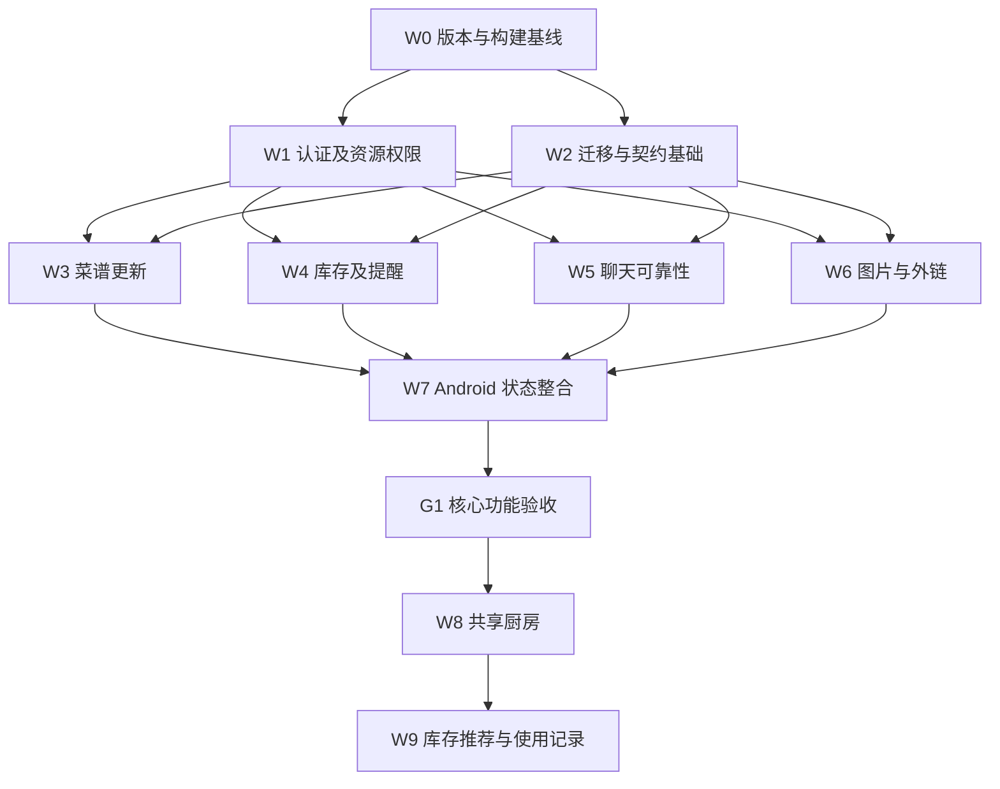

# 实施与验收计划

> 本文为首次候选设计。本轮范围已按用户要求缩小为未上线、单机、本地媒体的基础修复；现行决策与已实现内容见 [04 实施记录](./04-implementation.md)。迁移、共享厨房和 UI 重构不在本轮执行范围。

日期：2026-11-01\
状态：未实施；本次仅新增文档\
关联：[评审](./01-review.md) · [详细设计](./02-design.md)

## 1. 实施顺序

按可独立验证的工作包交付，不按文件逐个机械重构。安全修复与领域扩展分阶段，减少一次发布同时改变身份、数据库和客户端行为的风险。

依赖图表达功能依赖，不要求并行开发。若已有服务暴露于外网，W1 中关闭默认身份、去除敏感输出和限制未认证 WS 应优先作为最小修复发布，不等待 W2 全部完成。

## 2. 工作包

| 工作包 | 范围与产出 | 依赖 | 完成标准 |
| --- | --- | --- | --- |
| W0 运行基线 | 确认 APK／JAR 来源 commit、构建入口、数据库实际结构；修复悬空字段引用；补唯一启动说明 | 无 | 干净环境构建可复现；运行版本与源码对应关系有记录；数据备份可恢复 |
| W1 权限 | 严格认证、公开用户 DTO、菜谱可见性和写权限、库存归属、WS 身份、分类写入口限制 | W0；紧急修复可先行 | T01–T06、T17；旧 API 同样通过；无默认用户回退 |
| W2 契约与迁移 | 版本化迁移、DTO／错误模型、字段名与时间规则、并发 version；数据库初始与升级 fixture | W0 | T13、T14；迁移错误不被吞掉；接口契约快照固定 |
| W3 菜谱 | PATCH、旧 PUT 适配、保留未传集合、版本冲突、分享关联表、幂等收藏 | W1、W2 | T07、T08、T18；普通编辑不丢数据；计数不被内部读取污染 |
| W4 库存 | 分类链路、生命周期与临期计算、归属字段、整批消耗／撤销规则、提醒开关 | W1、W2 | T09、T10、T11；列表与提醒一致；所属人不影响权限 |
| W5 聊天 | 统一地址与消息 DTO、成员校验、幂等消息、ACK、序列游标、重连补拉和待发缓存 | W1、W2 | T05、T12、T19；REST 与 WS 共用写入逻辑 |
| W6 图片与外链 | asset 关联及授权读取、单图 UI、孤立文件回收、受限抓取与解析回归 | W1、W2 | T15、T16；私有业务的图片不匿名公开 |
| W7 客户端整合 | 首批 ViewModel／Repository、错误状态、登录失效、慢网生命周期、群／好友列表 | W3–W6 | T20、T21；可见入口均有完整成功／失败路径 |
| W8 共享厨房 | 厨房与成员、邀请接受、共享库存、显式转移、管理员转让和归档 | G1；确认产品默认决策 | T22、T23；个人数据不自动变共享 |
| W9 使用闭环 | 烹饪事实记录、近期统计、基于临期／库存的可解释推荐 | W8 | T24；无自动扣库存、无重复记录、不推荐不可见菜谱 |

W4 首轮仅整批消耗；撤销只允许同一资源仍为 consumed、版本匹配时回到 active，清空 consumed_at 并记录操作者。部分消耗留待数量／单位规范完成后实施，不能从“半袋”等文本猜测数值。

每个工作包宜拆为“服务端及测试”“兼容客户端”“清理旧路径”三个可评审提交组，但以实际依赖为准。不要为凑拆分而提交不能构建的中间版本。

## 3. 原始问题到实施项的映射

| 评审项 | 工作包 | 关键用例 |
| --- | --- | --- |
| 1 默认身份 | W1 | T01、T02 |
| 2 菜谱可见性与越权 | W1、W3 | T03、T04 |
| 3 用户密码摘要输出 | W1 | T06 |
| 4 WS 身份 | W1、W5 | T05 |
| 5 库存越权 | W1、W4 | T04、T09 |
| 6 上传和抓取边界 | W6 | T15、T16 |
| 7 编辑丢关联数据 | W3 | T07、T08 |
| 8 缺失字段与版本不一致 | W0、W2、W4 | T13、T14 |
| 9 临期提醒矛盾 | W4 | T10、T11 |
| 10 分类链路 | W4 | T09 |
| 11 聊天协议与可靠性 | W5 | T12、T19 |
| 12 迁移不可复现 | W2 | T13 |
| 13 图片没有业务关联 | W6 | T15 |
| 14 生命周期 | W7 | T20 |
| 15 API 契约 | W2、W7 | T14、T21 |
| 16 搜索、推荐与统计 | W3、W9 | T18、T24 |
| 17 测试与说明 | W0 及各工作包 | 所有用例；G1 发布记录 |
| 新增：分类写权限 | W1 | T17 |
| 新增：群成员计数 | W1、W5 | T19 |

## 4. 验收数据与场景

所有修改类用例在隔离环境执行。使用匿名、A（创建者）、B（同群）、C（外部）、D（已退群）；准备公开、私有、群组共享菜谱，以及各自个人库存、临期批次和已消耗批次。记录数据库初始与最终状态，不只断言 HTTP 200。

| 编号 | 操作 | 期望 |
| --- | --- | --- |
| T01 | 无 token／损坏／过期 token 写菜谱、库存、消息 | 401；无新增或修改记录 |
| T02 | 修改密码／退出所有设备后复用旧 token；WS 到期 | REST 拒绝；WS 被关闭且不能再发／收；普通本地退出行为与文档一致 |
| T03 | A/B/C/D 读取私有和共享菜谱的详情、搜索、收藏列表、推荐、total | 每个入口遵循同一矩阵；未授权数据和计数不泄漏 |
| T04 | B/C 修改 A 的个人菜谱／库存；隐藏按钮后直接请求 | 403 或 404；记录原值不变 |
| T05 | 匿名 WS、外部订阅、伪造 sender_id、移除成员后接收 | 认证／授权拒绝；发送者由会话决定；移除提交后不推新消息 |
| T06 | 遍历所有包含 user、creator、cooks、sender 的响应 | 任意层级无 password；日志无 token／密码 |
| T07 | 带食材、步骤、图片的菜谱只 PATCH 标题；旧 PUT 提交 null 集合 | 原关联完整保留；明确 [] 才清空 |
| T08 | 两个客户端用相同 version 编辑；事务中制造关联写入失败 | 仅一次成功，另一次 409；故障时所有数据回滚 |
| T09 | 新增分类库存、重启读取、一级／子类筛选、整批消耗后重试与撤销 | 分类稳定；无重复消耗；撤销校验版本；旧请求不能覆盖新状态 |
| T10 | 临期边界为昨天／今天／阈值当天／阈值后一天；打开列表前后查询 | 分别 expired／expiring／expiring／normal；读取不改变结果；消耗项不提醒 |
| T11 | 关闭提醒、授权不足、慢网、401、账号切换、重复 Worker | 不误报成功、不跨账号通知、不无限重试认证失败，同日去重 |
| T12 | release 真机发送；ACK 丢失重试；历史加载同时有实时消息；离线重连 | 同一消息一次展示；时间及发送者正确；不漏、不乱序；失败内容可恢复 |
| T13 | 空库安装、历史库升级、重复启动；包含错误 JSON／重复列／孤立引用 | 自动流程可重复；异常明确报告；不得静默扩大权限或丢数据 |
| T14 | 实际序列化 REST／WS 样例；非法字段、枚举、分页和 null | 命名、时间与 DTO 一致；错误 HTTP 状态正确；隐式字段丢失被检测 |
| T15 | 上传单图并保存／取消／删除；外部账号读取私有图；伪装图片和超大像素图 | 关联可回读；未关联文件按策略清理；私有图拒绝；非法内容拒绝 |
| T16 | 合法分享链接、多段短链、重定向至私网、IPv6 本地地址、超大响应和超时 | 合法链接不截断；受限目标无出站请求；抓取失败仍可保存原链接 |
| T17 | 普通用户直接调用分类创建／修改／删除 | 首轮接口关闭或明确拒绝，字典不变 |
| T18 | 重复设置收藏／取消收藏；创建／编辑后查看统计 | 状态幂等、计数一致；内部详情读取不增加浏览 |
| T19 | 重复成员、非好友、并发加人、管理员转让、跨群已读和倒退已读 | 不超上限；人数真实；唯一管理员；已读仅本群且单调 |
| T20 | 慢网期间切换 Fragment、旋转、搜索新词、进程重建 | 无 binding 崩溃；旧响应不覆盖新筛选；草稿保留 |
| T21 | 网络失败、空列表、服务端 500、登录过期、版本冲突 | 不混为同一种 Toast；有重试／登录／冲突入口；不清空草稿 |
| T22 | A 创建厨房，B 接受邀请；个人库存显式转移；C 伪造 kitchen_id | B 可维护共享库存；未转移个人库存仍私有；C 无权访问 |
| T23 | 转让／退出／归档厨房，并测试原成员与作者的后续权限 | 不出现无管理员厨房；退出后库存不可见；个人菜谱所有权不转移 |
| T24 | 重试记录做饭、临期食材推荐、无匹配和无库存 | 历史不重复；推荐理由可解释；仅使用可见数据；不自动扣库存 |

T12 的可靠性测试需覆盖消息写事务提交顺序、订阅 ACK 高水位和补拉分页边界，不能只验证两台设备各发一句。T16 使用受控测试端点／模拟 DNS，不探测真实内部系统。

## 5. 发布门槛

### G0 可复现基线

- [ ] 当前源码可构建；已解决 ownerUserId 等字段不一致。
- [ ] APK、JAR、数据库 schema 和配置版本有对应记录。
- [ ] 文档明确 Android 构建从 android/ 执行、后端从 backend/ 执行。
- [ ] 备份在隔离库完成一次恢复，图片目录／资源映射包含在恢复范围内。

### G1 核心功能可供多用户使用

- [ ] P0 权限／敏感字段用例通过，旧路径也无旁路。
- [ ] 菜谱修改不丢关联数据，库存和提醒计算一致。
- [ ] 所有新表／字段具备迁移，空库和旧库都能进入同一目标结构。
- [ ] 真机 release 使用正确 REST／WS 地址，图片可读且访问受控。
- [ ] 最小契约与集成测试进入自动检查，保留失败输出。
- [ ] 启动、升级、回退与数据恢复说明同发布版本一致。
- [ ] 没有把“未执行”测试标成通过。

### G2 共享厨房完成

- [ ] 确认 D02／D03／D04／D09 产品默认决策或记录修改。
- [ ] 共享邀请、成员退出、管理员转让和归档完整闭环。
- [ ] 个人数据没有因后台迁移自动公开。
- [ ] 跨账号／跨厨房的缓存、提醒、图片和聊天隔离测试通过。

## 6. 回退与故障处理

| 情况 | 处理 |
| --- | --- |
| W1 客户端出现大量 401 | 修正客户端会话与兼容处理；不重新开启默认用户模式 |
| 迁移结构预检失败 | 停止发布；保留当前库，输出差异，先在副本上修复和重演 |
| 新客户端 PATCH 不兼容 | 回退客户端功能开关或继续安全的旧 PUT 适配，不恢复清空 null 的行为 |
| 新聊天广播失败 | 暂停新发送入口或使用同业务服务的 REST 发送；历史补拉保留；不返回未经持久化的成功 ACK |
| 新增字段上线后应用失败 | 只在 schema 兼容时回退应用；保留新增列，排查后前向修复 |
| 已执行破坏性数据变更 | 停写、确认恢复点和可能丢失的数据范围后按恢复方案操作，不假设 SQL 事务可撤销 DDL |

## 7. 实施记录模板

每次实际工作补充以下字段；本轮尚无实现提交和测试结果。

| 字段 | 内容 |
| --- | --- |
| 工作包 | Wxx |
| 状态 | 待实施／实施中／已验收／已搁置 |
| 关联提交 | 待填写 |
| 变更 | 具体接口、模型、迁移与页面 |
| 验证 | 用例编号、执行命令／设备、实际结果 |
| 数据影响 | 回填范围、数据校验与兼容窗口 |
| 回退 | 已验证的兼容边界或恢复步骤 |
| 遗留项 | 未解决问题、未执行测试及原因 |

## 8. 本次文档交付记录

- 2026-11-01：归档首次静态评审；新增详细设计、优先级映射与验收计划。
- 仅新增 docs/iterations 下 Markdown 文件；未修改业务代码、配置和数据库。
- 文档检查：交付时检查相对链接、代码围栏、空白格式及变更范围。
- 应用构建、自动测试、迁移演练、真机验收：本轮未执行。
